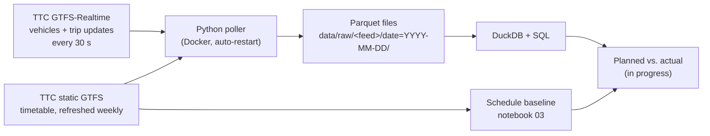

# TTC Bus Reliability Tracker

How closely do Toronto's buses and streetcars keep to their timetable, and where does bus bunching hurt riders most?

This project collects the TTC's GTFS-Realtime feed every 30 seconds on a self-hosted server, builds a scheduled baseline from the published timetable, and compares **planned vs. actual** headways for a set of study routes.

> **Status: work in progress.** The scheduled baseline (notebook 03) is complete. Realtime collection has been running since 17 October 2026; the planned-vs-actual analysis starts once at least one full week of weekday data is available.

## Key findings so far (scheduled baseline)

From the timetable for Wednesday 21 October 2026:

- **The TTC's GTFS splits many bus runs into separate trips at subway stations.** Counting trips at their first stop double-counts these routes and roughly halves their headways (e.g. 47 Lansdowne appeared to run every 3.5 min instead of about 7). Headways are therefore measured at each stop.
- **504 King** runs about every **4.5 min** on its King Street trunk at midday, but each branch (504A, 504B) only about every **9 min**.
- **939 Finch Express is scheduled more often than the local 39 Finch East** on their shared trunk (about 7.5 vs. 9 min at midday), and rises to about every 5 min in the AM peak.
- About 20 stops on the **939's eastern extension** (east of Markham Rd and a loop via Staines Rd / Nightstar Rd) see only one or two buses an hour at midday.

Full numbers and charts are in [`notebooks/03_schedule_analysis_en.ipynb`](notebooks/03_schedule_analysis_en.ipynb).

## Study routes

Listed in [`config/routes.txt`](config/routes.txt). They were chosen as pairs and contrasts rather than a sample of the whole network:

| Route | Type | Why it is included |
| --- | --- | --- |
| 504 King | Streetcar, downtown, two branches | Busiest surface route; trunk vs. branch service; streetcars cannot overtake |
| 25 Don Mills | Bus, north–south (east side) | Very frequent, no branches |
| 29 Dufferin | Bus, north–south (west side) | Local half of a local/express pair |
| 929 Dufferin Express | Express bus | Express half of the Dufferin pair |
| 39 Finch East | Bus, east–west (north) | Local half of a local/express pair |
| 939 Finch Express | Express bus | Express half of the Finch East pair; more frequent than its local |

Research questions:

1. Do actual headways match the schedule, by route, direction, segment and time of day?
2. How often do buses bunch (arrive much closer together than scheduled) or leave large gaps?
3. Do express routes keep their headways better than the locals on the same corridor?
4. On 504 King, do the two branches combine into an even trunk service, or arrive together?

## Architecture



| Component | Tool | Why |
| --- | --- | --- |
| Collection | Python, `gtfs-realtime-bindings`, `requests` with retries | GTFS-RT is protobuf; one failed request never stops the poller |
| Runtime | Docker Compose on a home Mac mini | `restart: unless-stopped`, log rotation, no cloud cost |
| Storage | Parquet, Hive-partitioned by date | Compressed and columnar; new files are picked up automatically |
| Analysis | DuckDB, pandas | SQL directly over Parquet, no database server |
| Spatial | GeoPandas | 500 m catchment analysis, GeoJSON export for QGIS / Power BI |

The poller and the notebooks never talk to each other directly: the poller writes Parquet files, and the notebooks read the same folder.

## Repository structure

```
ttc-bus-reliability/
├── src/poller.py                       # GTFS-RT collector (runs in Docker)
├── config/routes.txt                   # study routes
├── notebooks/
│   ├── 01_explore.ipynb                # first look at static and realtime GTFS
│   ├── 02_checknow.ipynb               # check the poller's collected data
│   └── 03_schedule_analysis_en.ipynb   # scheduled baseline, frequent network, 500 m coverage
├── Dockerfile
├── docker-compose.yml
├── requirements.txt                    # poller dependencies
├── requirements-analysis.txt           # notebook dependencies
└── data/                               # raw and processed data (git-ignored)
```

## Methods: scheduled baseline

- **Service day**: one representative weekday (Wednesday 21 October 2026), with `calendar.txt` and `calendar_dates.txt` exceptions applied. GTFS times past 24:00 (e.g. `25:30`) belong to the same service day.
- **Periods**: AM peak 06–09, Midday 09–15, PM peak 15–19, Evening 19–22, Late evening 22–01.
- **Headway at each stop**: for every route, direction and period, count the trips passing each timed stop, take the median across stops, and divide the period length by that count. This avoids the split-trip double count described above.
- **Direction**: kept separate, because each direction is an independent stream of buses. For the network-wide frequent classification the less frequent direction is used.
- **Trunk, branch and occasional stops**: each stop is compared with the busiest stop on the same route and direction at midday. Trunk ≥ 75% of its trips, branch 25–75%, occasional < 25% (excluded from the baseline).
- **Frequent network**: headway ≤ 10 min in the AM peak, midday and PM peak.
- **Coverage**: 500 m straight-line buffers around frequent stops, in EPSG:2952 (metres).

## Validation

- [x] Duplicate trips: 16 possible duplicates out of tens of thousands; negligible.
- [x] Split trips at subway stations: found and corrected (headway measured at each stop).
- [x] Branches: checked with the max/min ratio of trips per stop; routes 504, 29, 39 and 939 have branches or extensions, 25 and 929 do not.
- [x] Threshold sensitivity: the trunk classification is unchanged for thresholds between 60% and 80%; at 90%, short-turning trips on 39 and 939 start to be misclassified.
- [ ] Compare scheduled headways for the study routes against the TTC Service Summary for the same board period.

## How to run

**Collector** (needs Docker):

```bash
git clone https://github.com/catyingyingcoco/ttc-bus-reliability.git
cd ttc-bus-reliability
docker compose up -d --build
docker compose logs -f poller
```

Data is written to `data/raw/`. The poller downloads the static GTFS on start-up and refreshes it weekly.

**Notebooks** (Python 3.12):

```bash
python3.12 -m venv .venv
source .venv/bin/activate
pip install -r requirements-analysis.txt
```

Open the notebooks in VS Code or Jupyter and select the `.venv` kernel.

## Limitations

- The 500 m catchment uses straight-line distance; real walking distances are longer.
- Route-level frequency ignores corridors where several routes share a street.
- The baseline uses one weekday; weekends and holidays differ.
- Segment thresholds are heuristic (see the sensitivity test).
- Late-evening headways can look extreme where a route ends service just after 22:00, because only a few stops see its last trips.
- The collector runs on a home server, so power or internet outages leave gaps in the realtime data; gaps will be flagged in the analysis.

## Roadmap

- [x] Self-hosted GTFS-Realtime collector with Docker
- [x] Scheduled baseline by route, direction and segment
- [x] Frequent network and 500 m coverage
- [ ] Validate the baseline against the TTC Service Summary
- [ ] Estimate actual arrival times at stops from vehicle positions
- [ ] Actual headways, bunching rate, gap rate and headway coefficient of variation vs. the baseline
- [ ] Dashboard
- [ ] Network-based walksheds (OSMnx) and population coverage (census dissemination areas)

## Data and licence

- TTC static GTFS (Surface routes) and GTFS-Realtime feeds (`https://bustime.ttc.ca/gtfsrt/vehicles`, `https://bustime.ttc.ca/gtfsrt/trips`), published through [City of Toronto Open Data](https://open.toronto.ca/) under the Open Government Licence – Toronto. Raw data is not included in this repository.
- Code is released under the [MIT License](LICENSE).
